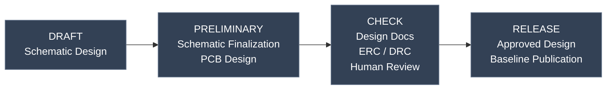

# [Project Name]

**[One-sentence description of the hardware project.]**

[Optional: Insert a PCB 3D render, board photograph, or system overview image.]

## Overview

[Briefly describe the purpose of the project, its intended application, and the main engineering objectives.]

## Key Features

- [Primary hardware feature]
- [Secondary hardware feature]
- [Notable architecture or design feature]

## Specifications

| Parameter | Specification |
|---|---|
| [Parameter 1] | [Value and unit] |
| [Parameter 2] | [Value and unit] |
| [Parameter 3] | [Value and unit] |

*Specifications describe design targets unless explicitly identified as measured or verified results.*

## Project Status

**Current Phase:** `[Human-declared phase, if available]`

| Phase | Description |
|---|---|
| DRAFT | Schematic design in progress |
| PRELIMINARY | Schematic nearly complete; PCB design started |
| CHECK | Design mostly finalized; human-led verification |
| RELEASE | Human-approved design baseline released |

*The current phase is declared by the project owner. It does not independently establish design correctness or approval.*

### Project Workflow Diagram



Phase changes are declared by a human engineer.

- Slate: not started
- Amber: current phase, under review
- Green: completed

The diagram is for reference only. It does not enforce gates or approve releases.

## Hardware Design

### Architecture

[Briefly describe the main functional blocks and how they interact.]

[Optional: Link to a block diagram or architecture documentation.]

### Design Considerations

- [Important design constraint or tradeoff]
- [Relevant interface, electrical, mechanical, or thermal consideration]
- [Additional design note]

## Repository Structure

```text
Project/
├── README.md
├── Project.kicad_pro
├── Project.kicad_sch
├── Project.kicad_pcb
├── library/
└── ...
```

[Adapt this tree to match the actual repository.]

## Documentation

| Resource | Description |
|---|---|
| [Schematic](path/to/file) | Schematic documentation |
| [PCB Layout](path/to/file) | PCB layout or preview |
| [BOM](path/to/file) | Bill of materials |
| [Other](path/to/file) | Additional documentation |

*Include only links to files that actually exist.*

## Results

[Optional: Summarize verified measurements, prototype results, or evaluation outcomes. Omit this section if not applicable.]

## References

[Optional: List relevant manufacturer documentation, design references, or related projects.]

## License

[Specify the applicable hardware license and reference the LICENSE file, if available.]
