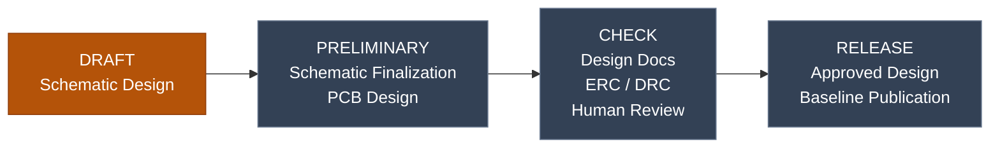

<p align="center">
  
</p>

> **Status:** `DRAFT`
> **Board revision:** `v1.0`
> **Baseline:** `NOT_ESTABLISHED`
> **KiCad:** `10.0.7`

> **Draft specification (rev 0.17, 2026-10-28): NOT FOR FABRICATION.** Everything below is a design target from the specification, not a verified result. Values not yet decided are shown as `TBD`.

## Overview

AeroOptix-Horizon is a custom PX4 flight controller with two MCUs. The STM32H743VIT6 is the main flight-controller MCU and drives the 4 motor outputs. The STM32F100C8T6B is the IO MCU: it runs PX4 IO firmware (px4io) and drives the 8 servo outputs, the safety switch and the servo failsafe. A USART link connects the two MCUs.

Pixhawk 6C and Pixhawk 6X are conceptual and functional references. Their schematics and PCBs are not copied. By team decision, the H743 pins mostly follow Pixhawk 6C (`px4/fmu-v6c`) and the F100 pins follow `px4/io-v2` (DEC-014).

The team website, [natchpai.github.io/AeroOptix-Horizon](https://natchpai.github.io/AeroOptix-Horizon/), shows the block diagram, the MCU pinouts and the project status. It is built from the design records on each merge to `main` and adds no values of its own.

## Key Features

- Main MCU: STM32H743VIT6
- IO MCU: STM32F100C8T6B running px4io (8 servo outputs, safety switch)
- 8 servo headers (signal, +6 V, GND) on an on-board 6 V servo rail fed by a UBEC through a board-mount XT30, Pixhawk style
- H743 to F100 link over USART, px4io protocol at 1.5 Mb/s
- 4 motor outputs on the H743 (TIM5, DShot with RPM feedback), 3 spare outputs
- 2× SPI IMU (ICM-45686), 2× I2C barometer (ICP-20100 + BMP581), 1× I2C magnetometer (IST8310)
- 5 V board input through a TPS16412DRC eFuse (1.5 A limit)
- 3.3 V rail from a TPS62142RGTR buck on the 5 V board input
- USB FS, microSD (SDMMC1), H743 debug on a Pixhawk Debug Mini connector, F100 SWD pads, selectable BOOT0 on the H743
- If the H743 stops, the F100 holds the servos at failsafe values after 0.5 s and the motors stop when their DShot signal stops (no landing)

## Specifications

| Parameter | Specification |
|---|---|
| Main MCU | STM32H743VIT6 |
| IO MCU | STM32F100C8T6B (px4io) |
| Clocks | H743 16 MHz crystal; F100 24 MHz crystal (stock px4io-v2) |
| Inter-MCU link | H743 USART6 to F100 USART2, px4io protocol, 1.5 Mb/s |
| Outputs | 4 motors (H743 TIM5, DShot only); 8 servos (F100, 50 Hz PWM); 3 spare (H743) |
| IMU | 2× SPI, ICM-45686 |
| Barometer | 2× I2C, ICP-20100 + BMP581 (BMP384 fallback) |
| Magnetometer | 1× I2C, iSentek IST8310 (DEC-011, replaced BMM150) |
| Board input | 5 V from power module, 4.5 to 5.5 V, 2 A source; TPS16412DRC eFuse, limit 1.5 A (DEC-024) |
| 3.3 V rail | TPS62142RGTR buck from 5 V, 2 A part (load current `TBD`) |
| 3.3 V IMU rail (`+3V3A`) | Feeds only the 2 IMUs, VDD and VDDIO (DEC-025); LDO part `TBD` (TPS73533DRBR drawn, not decided) |
| Servo supply | 6 V from a UBEC into a board-mount XT30 and the on-board servo rail, 10 A continuous, 15 A instantaneous (XT30 rating and protection `TBD`, OPEN-021) |
| Board outline | Each dimension under 80 mm; exact outline `TBD`; part height about 10 to 15 mm |
| Mounting | M3 screws, 3.2 mm holes, soft mount on a separate tray; hole pattern and dampers `TBD` (set by hardware at placement) |
| Copper layers / stackup | `TBD` |
| Operating / storage temperature | Parts rated −40 to +85 °C; no conformal coating, no rain (DEC-020) |
| Vibration and shock | `TBD` |

*Specifications describe design targets unless explicitly identified as measured or verified results.*

## Project Status

**Current Phase:** `DRAFT`

| Phase | Description |
|---|---|
| DRAFT | Schematic design in progress |
| PRELIMINARY | Schematic nearly complete; PCB design started |
| CHECK | Design mostly finalized; human-led verification |
| RELEASE | Human-approved design baseline released |

*The project owner declares the current phase. It does not independently establish design correctness or approval.*

### Project Workflow Diagram



> Slate: not started, Amber: current phase, Green: completed

The diagram is for reference only. It does not enforce gates or approve releases.

### Design progress

State of the saved KiCad files on 2026-10-28. Details are in the specification (4.3 "Schematic state", 4.6 "Library state").

| Area | State |
|---|---|
| Schematic | Only `power_supplies.kicad_sch` has parts (28, all unannotated): power module connector, TPS16412DRC eFuse with its fault LED, TPS62142RGTR buck behind a ferrite bead, TPS73533DRBR LDO and a 3.3 V LED. The eFuse is wired from `+VIN` to `+5V`, except its EN/~SHDN pin, and six of its part values are still `?`. The other sheets hold no parts. |
| PCB | Empty: no footprints and no board outline. |
| Library | Project symbols, footprints and 3D models for the MCUs, regulators, ESD parts, connectors and passives. Sensor symbols and footprints are starting points: their pin maps match the datasheet tables, but land patterns and pin 1 orientation are not checked yet. A BMP581 symbol is a starting point for the second barometer, and the Bosch LGA-10 footprint pads now follow the BMP581 land pattern (not checked against the drawing). The IST8310 uses the stock KiCad symbol and `LGA-16_3x3mm_P0.5mm` footprint; its datasheet has no land pattern, so the fit is estimated. A read-only link audit found no broken links. |
| ERC / DRC | Not run. |

## Hardware Design

### Architecture

| Block | Role |
|---|---|
| H743 main controller | Primary flight-controller processing and interface host |
| F100 IO controller | px4io: 8 servo outputs, safety switch and LED, servo rail sense, servo failsafe |
| IMU / barometer / magnetometer | 2 IMU on SPI1 and SPI4; 2 barometers and the magnetometer on I2C2 |
| H743 external I/O | Telemetry/RC (ELRS), GPS, compass, air-data sensor, rangefinder, power module, 4 motor outputs, 3 spare outputs, microSD, buzzer, LEDs |
| USB / debug / BOOT0 | USB FS, H743 debug connector (console + SWD), F100 SWD pads |
| Power | 5 V board input, 3.3 V buck, 6 V servo supply |

The specification's candidate power chain (6S battery, XT90-S, PM02D, CRIUS PDB v1.0, 6 V UBEC) comes from user diagrams and is not an approved design.

### External interfaces

Peripheral allocations agreed with the software team (DEC-014, DEC-018). Pins are in the pin allocation record and pinmap review 0.3. Electrical levels, protection and connector pinouts are `TBD` and not verified.

| Interface | Function | Allocation |
|---|---|---|
| Tel1 | ELRS receiver: RC and telemetry (MAVLink), JST-GH 6-pin | UART7 |
| Tel2 | Telemetry 2 (free) | USART1 |
| GPS1 + compass | GPS and compass (single GPS), 10-pin full GPS port with safety switch lines | USART2 + I2C1 |
| Debug | H743 console and SWD, Pixhawk Debug Mini | USART3 + SWD |
| MS4525DO + PM02D | Air-data sensor (`0x28`) and power module (`0x45`) | I2C4 |
| TF-Luna | Rangefinder | UART8 |
| Motors 1 to 4 | 4 × Skywalker 80A V2 ESCs, 3-pin headers with the + pin removed. Spec says DShot only; the ESC looks PWM-only (OPEN-017) | TIM5_CH1 to CH4 |
| Spare 1 to 3 | Spare outputs | TIM4_CH3, TIM4_CH4, TIM1_CH1 |
| microSD | Flight logs | SDMMC1, 4-bit |
| Buzzer | PX4 tone alarm | TIM3_CH3 |
| F100 servos 1 to 8 | Flaperon L/R, ruddervator L/R, tilt servo 1 to 4 | TIM2_CH1/CH2, TIM4_CH3/CH4, TIM3_CH1 to CH4 |
| F100 safety | Safety button and LED, through GPS1; disabled in PX4 on Model G | GPIO |

### Design Considerations

- The software team's pinmap answers were applied in spec rev 0.11 and 0.12 (DEC-014 to DEC-018). The software team signed decisions D1 to D7 as proposals for the team; a separate whole-team confirmation is not recorded.
- The IO MCU changed from STM32F103C8T6 to STM32F100C8T6B on 2026-10-24, following the software team (DEC-002, DEC-017). Stock PX4 IO firmware expects a 24 MHz crystal, which is outside the F103 range (4 to 16 MHz) and inside the F100 range (4 to 24 MHz). With the F100, stock px4io runs unchanged. No pin moved.
- The software team answered the integration questions on 2026-10-24 (spec rev 0.13, DEC-019 to DEC-022). The human owner changed their servo answer: the servos plug into 3-pin headers on an on-board 6 V rail, and the UBEC plugs into a board-mount XT30 (DEC-019). The XT30 carries up to 10 A continuous and 15 A peak; its rating is not checked (OPEN-021).
- GPS1 is a 10-pin full GPS port (DEC-021). PC1 stays reserved for an analog power module (DEC-023). No ESC current sense or telemetry (IF-052, IF-053 removed). The connector pinouts are not checked against the Pixhawk standard yet. The PM02D connector will be a CLIK-Mate to match its cable; the power sheet still draws JST-GH (OPEN-023).
- The team's ESCs are 4 × Skywalker 80A V2. No source says they support DShot. With PWM, the motors may keep running after an H743 hang, which conflicts with FUN-002 and SAF-015. Asked the team in D13 (OPEN-017).
- USB powers the board and all external 5 V ports on the bench. The VBUS budget and back-feed through the eFuse are open (OPEN-006, OPEN-012).
- PWM lines get weak pull-downs; the value must still let bidirectional DShot work (OPEN-018).
- Sourcing risk on the sensors (OPEN-004): ICP-20100 is EOL (TDK says its pressure products are not for new designs), BMP581 stock is short, and the IST8310 lifecycle is not confirmed.
- The magnetometer changed from BMM150 to IST8310 (DEC-011). Its absolute maximum supply is 3.6 V, so the 3.3 V rail has only 0.3 V of margin.
- BMP390 was removed because LCSC does not sell it. The team accepted BMP581 as the second barometer, with BMP384 as fallback; the fallback fit is not checked (OPEN-019).
- The power sheet is in progress: the `+VIN` to `+5V` eFuse (TPS16412DRC, DEC-024) is wired, but its EN/~SHDN pin has no connection and its ILIM, OVP, IMON, IDLY and dV/dt part values are not set (OPEN-012), and the `+3V3A` LDO part is not decided (OPEN-011). `+3V3A` feeds only the 2 IMUs, on VDD and VDDIO (DEC-025); the SPI level match with the H743 on `+3V3` is not checked yet. As drawn, the LDO's NR capacitor (100 nF) is above TI's 0.01 µF limit, and the TPS62142 lacks the 0.1 µF AVIN capacitor TI recommends.
- Power budgets, rail tolerances, sequencing, brownout/reset thresholds and protection (reverse polarity, overvoltage, ESD, short circuit) are `TBD`.
- Crystal parts, load capacitors and reset topology are `TBD`.
- Firmware is owned by the software team: PX4 v1.16.2, port based on `px4/fmu-v6c`. The PX4 Matek H743-Slim board port is kept in `documents/reference/` as a pin-map reference only.
- Confirmed part numbers: STM32H743VIT6, STM32F100C8T6B, ICM-45686, ICP-20100, BMP581, IST8310, TPS62142RGTR and TPS16412DRC. All other parts are `TBD`.

## Verification

| Check | Result | Evidence |
|---|---|---|
| Schematic ERC | `NOT_VERIFIED` | Not run |
| PCB DRC | `NOT_VERIFIED` | Not run; PCB is empty |
| Connectivity / pin review | `NOT_VERIFIED` | `TBD` |
| BOM / footprint review | `NOT_VERIFIED` | `TBD` |
| Prototype functional test | `NOT_VERIFIED` | `TBD` |

## Open Items

The specification tracks OPEN-001 to OPEN-023. Closed: OPEN-002, OPEN-003, OPEN-005, OPEN-008, OPEN-014, OPEN-015, OPEN-016, OPEN-020, OPEN-022. Open:

- MCU pins: pinmap review 0.3 answered by the team, not in the schematic yet (OPEN-001)
- Sensor electrical data and sourcing (OPEN-004)
- 5 V and 6 V budgets and protection (OPEN-006, OPEN-007)
- Board outline, cable entry sides and dampers, set by hardware at placement (OPEN-009); environment set by DEC-020
- Remaining non-MCU part numbers (OPEN-010)
- `+3V3A` LDO part and IMU SPI level match (OPEN-011) and the `+VIN` to `+5V` eFuse wiring and values (OPEN-012)
- Sensor footprints to check against the datasheet drawings and app notes (OPEN-013)
- Motor stop on an H743 hang with PWM-only ESCs (OPEN-017, team question D13)
- PWM pull-down value with bidirectional DShot (OPEN-018)
- BMP384 fallback fit (OPEN-019)
- On-board servo rail: XT30 rating, copper and GND (OPEN-021)
- External connector pinouts and the PM02D connector (OPEN-023)

## How we work

1. A human engineer makes every design decision and declares the phase. Decisions go into the specification first.
2. The execution checklist tracks each task and the evidence needed to close it. A task is `DONE` only with a named evidence record.
3. The saved KiCad files are the design authority. The Markdown records describe them and never replace them.
4. New library parts start from the stock KiCad library where it fits, use KLC names with a `0_` family prefix, and get a link check before use.
5. After design work, the docs are updated in this order: specification, checklist, design records, README, CHANGELOG.
6. Datasheet values come from official sources and are labeled `VERIFIED`, `ASSUMED`, `ESTIMATED` or `NOT_VERIFIED`. ERC and DRC results are evidence, not proof of a correct design.
7. Changes go through `dev` and a pull request to `main` (see `.github/pull_request_template.md`), with Conventional Commits.

Claude Code support for this workflow (rules, skills and file protection) is in `.claude/` and `CLAUDE.md`.

## Repository Structure

```text
AeroOptix-Horizon/
├── hardware/AO-Horizon/
│   ├── AO-Horizon.kicad_pro           # KiCad project settings
│   ├── AO-Horizon.kicad_sch           # Root schematic
│   ├── *.kicad_sch                    # Sheets: top_hierarchical, block_diagram,
│   │                                  #   power_supplies, revision_history
│   ├── AO-Horizon.kicad_pcb           # PCB source
│   ├── sym-lib-table, fp-lib-table    # Project library tables
│   ├── library/
│   │   ├── symbols/                   # 0_<Family>.kicad_symdir
│   │   ├── footprints/                # 0_<Family>.pretty
│   │   └── 3D/                        # 3D models by family
│   ├── documents/
│   │   ├── design/                    # Specification, checklist, design records
│   │   ├── reference/                 # Third-party reference files (PX4 board port)
│   │   ├── manufacturing/             # Fab/assembly notes and outputs
│   │   ├── schematic/                 # Schematic diagram outputs
│   │   ├── verification/              # Review reports and test evidence
│   │   └── images/                    # Documentation images
│   └── templates/                     # Worksheets, theme, fab/assembly notes
├── web/                               # Team website (Vite + React), built from the records
├── assets/                            # README title image
├── .claude/                           # Claude Code rules, skills and hooks
├── .github/                           # Pull request template, Pages deploy workflow
├── CLAUDE.md
├── CHANGELOG.md
├── LICENSE
└── README.md
```

## Documentation

| Resource | Description |
|---|---|
| [Specification](hardware/AO-Horizon/documents/design/AO-HORIZON_SPEC_EN.md) | Requirements, decisions, schematic and library state, open items |
| [Execution checklist](hardware/AO-Horizon/documents/design/AO-HORIZON_EXECUTION_CHECKLIST_EN.md) | Work plan and evidence tracker |
| [IMU selection](hardware/AO-Horizon/documents/design/AO-HORIZON_IMU_SELECTION_EN.md) | ICM-45686 selection record |
| [Barometer and magnetometer selection](hardware/AO-Horizon/documents/design/AO-HORIZON_BARO_MAG_SELECTION_EN.md) | ICP-20100, BMP581 and IST8310 selection and lifecycle (BMM150 replaced), BMP390 removal |
| [Power budget](hardware/AO-Horizon/documents/design/AO-HORIZON_POWER_BUDGET_EN.md) | Draft rail and load budget (P0-017) |
| [Pin allocation](hardware/AO-Horizon/documents/design/AO-HORIZON_PIN_ALLOCATION_EN.md) | Draft H743 and F100 pin allocation (rev 0.6) |
| [Pinmap review](hardware/AO-Horizon/documents/design/AO-HORIZON_PINMAP_REVIEW_EN.md) | Pinmap review 0.3, answered by the software team (0.2 answers kept) |
| [Pinmap decisions](hardware/AO-Horizon/documents/design/AO-HORIZON_PINMAP_DECISIONS_EN.md) | Team decisions and software answers behind DEC-014 to DEC-018 |
| [Integration questions](hardware/AO-Horizon/documents/design/AO-HORIZON_INTEGRATION_QUESTIONS_EN.md) | Open questions for the team (rev 0.4): ESC (D13), parts and team tests. Earlier answers applied in spec rev 0.13 and 0.14 |
| [H7 MCU sourcing](hardware/AO-Horizon/documents/design/AO-HORIZON_H7_MCU_SOURCING_EN.md) | STM32H743VI price and stock |
| [KiCad project](hardware/AO-Horizon/README.md) | Project folder layout |
| [Team website](https://natchpai.github.io/AeroOptix-Horizon/) | Block diagram, MCU pinouts and status, built from these records ([source](web/README.md)) |

## License

Copyright (c) 2026 AeroOptix Club.

The hardware design files are licensed under CERN-OHL-S-2.0.

The complete license text is available in:

[CERN Open Hardware Licence Version 2 - Strongly Reciprocal](LICENSE)

## Changelog

See [`CHANGELOG.md`](CHANGELOG.md).
