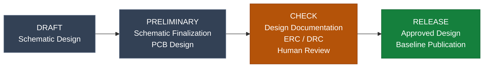

# AeroOptix-Horizon

High-performance dual-MCU flight controller powered by STM32H7 & STM32F1 by AeroOptix Club.

> **Status:** `CONCEPT`
> **Revision:** `v1.0`
> **Baseline:** `NOT_ESTABLISHED`
> **KiCad:** `10.0.7`

## Overview

AeroOptix-Horizon is a custom PX4 flight controller hardware platform with a dual-MCU architecture. The STM32H743VIT6 is the main flight-controller MCU. The STM32F103C8T6 is an auxiliary MCU for expanded I/O, PWM/ESC control and safety behavior. The two MCUs are linked by USART.

Pixhawk 6C is used as a conceptual and functional reference only. Its schematic, PCB and pinout are not copied.

> **Draft specification (rev 0.1, 2026-10-12): NOT FOR FABRICATION.** Everything below is a design target taken from the specification, not a verified result. Values not yet decided are shown as `TBD`.

## Key Features

- Main MCU: STM32H743VIT6
- Auxiliary MCU: STM32F103C8T6 (PWM/ESC, expanded I/O, safety)
- H743 to F103 link over USART
- 2× SPI IMU, 2× I2C barometer, 2× I2C magnetometer interfaces
- USB FS, SWD on both MCUs, selectable BOOT0 on the H743
- F103 commands immediate landing if the H743 is not operating (detection and timing `TBD`)

## Specifications

| Parameter | Specification |
|---|---|
| Main MCU | STM32H743VIT6 |
| Auxiliary MCU | STM32F103C8T6 |
| Inter-MCU link | USART (instance, pins, levels, rate `TBD`) |
| IMU | 2× SPI, parts `TBD` |
| Barometer | 2× I2C, parts `TBD` |
| Magnetometer | 2× I2C, parts `TBD` |
| Board input | 5 V from power module (tolerance and current `TBD`) |
| Servo supply | 6 V (current and protection `TBD`) |
| Board outline | Approx. 90 mm × 95 mm from diagram; exact outline `TBD` |
| Mounting pattern | `TBD` |
| Copper layers / stackup | `TBD` |
| Operating / storage temperature | `TBD` |
| Vibration and shock | `TBD` |

*Specifications describe design targets unless explicitly identified as measured or verified results.*

## Project Status

**Current Phase:** `DRAFT`

| Phase | Description |
|---|---|
| DRAFT | Schematic design in progress |
| PRELIMINARY | Schematic nearly complete; PCB design started |
| CHECK | Design mostly finalized; human-led verification |
| RELEASE | Human-approved design baseline released |

*The current phase is declared by the project owner. It does not independently establish design correctness or approval.*

### Project Workflow Diagram



Phase transitions require an explicit human declaration. The diagram describes
typical phase activities only; it does not highlight the current phase,
automate transitions, enforce gates, or authorize Git tags or GitHub releases.

<!-- Suggested STATUS_TOKEN values: CONCEPT, SCHEMATIC_IN_PROGRESS,
SCHEMATIC_REVIEW_REQUIRED, READY_FOR_PCB_DESIGN, PCB_LAYOUT_IN_PROGRESS,
PCB_REVIEW_REQUIRED, READY_FOR_FABRICATION, PROTOTYPE_BUILT, VALIDATED,
RELEASED, NOT_READY, NOT_VERIFIED -->

## Hardware Design

### Architecture

| Block | Role |
|---|---|
| H743 main controller | Primary flight-controller processing and interface host |
| F103 auxiliary controller | PWM/ESC outputs, expanded I/O, safety function |
| IMU / barometer / magnetometer | Two of each; parts and bus allocation `TBD` |
| H743 external I/O | Telemetry, GPS, compass, air-data sensor, rangefinder, logical outputs |
| F103 PWM / I/O | TILT, ESC, COAX, AIL outputs and FlySky bulk header |
| USB / SWD / BOOT0 | Service, debug and recovery access |
| Power | 5 V board input and 6 V servo supply |

The specification's candidate power arrangement (6S battery, XT90-S, PM02D, CRIUS PDB v1.0, 6 V UBEC) comes from user diagrams and is not an approved design.

### External interfaces (logical level)

Allocations below are user-confirmed at the logical level only. Exact pins, alternate functions, electrical levels and protection are `TBD` and not verified.

| Interface | Function | Allocation |
|---|---|---|
| Tel1 | Telemetry 1 | UART7 |
| Tel2 | Telemetry 2 | UART1 |
| GPS1 + compass | GPS and compass | UART2 + I2C1 |
| GPS2 | Reserved | UART3 |
| MS4525DO | Air-data sensor | I2C4, address `0x28` |
| TF-Luna | Rangefinder | UART8 |
| VT L / VT R | H743 outputs | TIM4_CH3 / TIM4_CH4 |
| SP2 | Reserved output | TIM1_CH1 |
| TL2 / TR2 | H743 outputs | TIM15_CH1 / TIM15_CH2 |
| F103 TILT L/R | F103 outputs | TIM2_CH1 / TIM2_CH2 |
| F103 ESC L/R | F103 outputs | TIM4_CH3 / TIM4_CH4 |
| F103 COAX T/B, AIL L/R | F103 outputs | TIM3_CH5..CH8 (labels as provided) |
| F103 FlySky | Bulk pin header | Pinout `TBD` |

### Design Considerations

- Timer/channel validity of the H743 and F103 labels is unconfirmed (OPEN-003). The same timer channels appear on both MCUs, and TIM3 labels CH5..CH8 need checking against the STM32F103 datasheet.
- Power budgets, rail tolerances, sequencing, brownout/reset thresholds and protection (reverse polarity, overvoltage, ESD, short circuit) are `TBD`.
- Clock sources, reset topology and F103 boot behavior are `TBD`.
- Safety detection method, timing and output ownership for the H743-failure case are `TBD`.
- Firmware (PX4 version and target, bootloader, USART message protocol) is deferred.
- Only STM32H743VIT6 and STM32F103C8T6 are confirmed part numbers. All other parts are `TBD`.

## Verification

| Check | Result | Evidence |
|---|---|---|
| Schematic ERC | `NOT_VERIFIED` | `TBD` |
| PCB DRC | `NOT_VERIFIED` | `TBD` |
| Connectivity / pin review | `NOT_VERIFIED` | `TBD` |
| BOM / footprint review | `NOT_VERIFIED` | `TBD` |
| Prototype functional test | `NOT_VERIFIED` | `TBD` |

## Open Items

Ten open items (OPEN-001 to OPEN-010) are tracked in the specification: pin and alternate-function validity, USART details, timer validity, sensor part numbers, second magnetometer allocation, 5 V and 6 V budgets, safety timing, board outline and mounting, and all non-MCU part numbers.

## Repository Structure

```text
├── hardware/AO-Horizon/
│   ├── AO-Horizon.kicad_pro           # KiCad project settings
│   ├── AO-Horizon.kicad_sch           # Root schematic
│   ├── *.kicad_sch                    # Sheets: top_hierarchical, block_diagram,
│   │                                  #   power_supplies, revision_history
│   ├── AO-Horizon.kicad_pcb           # PCB source
│   ├── library/
│   │   ├── symbols/                   # Project-specific symbols
│   │   ├── footprints/                # Project-specific footprints
│   │   └── 3D/                        # Project-specific 3Ds
│   ├── documents/
│   │   ├── design/                    # Specification, handoff, execution checklist
│   │   ├── manufacturing/             # Fab/assembly notes and outputs
│   │   ├── schematic/                 # Schematic diagram outputs
│   │   ├── verification/              # Review reports and test evidence
│   │   └── images/                    # Documentation images
│   └── templates/                     # Worksheets, theme, fab/assembly notes
│
├── .github/                           # Pull request template
├── LICENSE
├── CHANGELOG.md
└── README.md
```

## Documentation

| Resource | Description |
|---|---|
| [Advanced specification](hardware/AO-Horizon/documents/design/AO-HORIZON_ADVANCED_SPEC_EN.md) | Draft requirements, interfaces and open items |
| [Handoff](hardware/AO-Horizon/documents/design/AO-HORIZON_HANDOFF_EN.md) | Design handoff notes |
| [Execution checklist](hardware/AO-Horizon/documents/design/AO-HORIZON_EXECUTION_CHECKLIST_EN.md) | Execution checklist |

## License

Copyright (c) 2026 AeroOptix Club.

The hardware design files are licensed under CERN-OHL-S-2.0.

The complete licence text is available in: </br>
[CERN Open Hardware Licence Version 2 - Strongly Reciprocal](LICENSE)

## Changelog

See [`CHANGELOG.md`](CHANGELOG.md).
