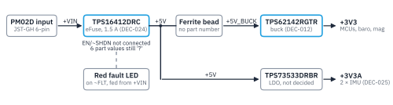

The power sheet (`power_supplies.kicad_sch`) now holds 28 parts and is mostly wired. The TPS16412DRC eFuse connects `+VIN` to `+5V`, the TPS62142RGTR buck makes `+3V3` and the TPS73533DRBR LDO makes `+3V3A` for the two IMUs. Two items need work before the sheet can be reviewed: the eFuse EN/~SHDN pin has no connection, and six eFuse part values are still `?`. One part-number code (LCSC C22548) was copied onto resistors of other values. All parts are unannotated and ERC has not been run. This report records what is drawn. It does not approve the design.

## 1. Scope and status

This report covers one sheet of the AO-Horizon flight controller: the power input and the 3.3 V rails. It is for the AeroOptix team, so everyone sees the same state before the next design step.

Table: Status and sources
| Item | Value |
| --- | --- |
| Project phase | `DRAFT` (declared in the root README) |
| Specification | `AO-HORIZON_SPEC_EN.md` rev 0.17, 2026-10-28 |
| Checklist | `AO-HORIZON_EXECUTION_CHECKLIST_EN.md` rev 0.16 |
| Design baseline | Not established |
| File read | Saved `power_supplies.kicad_sch`, uncommitted changes after commit `e15be06` |
| Tools | `sch-inspect` pin and net queries, `progress-update` preflight |
| ERC / DRC | Not run |

> **Not a verification record.** Every value in this report keeps the evidence label it has in the specification. ERC and DRC have not run, and a later ERC pass would not prove the circuit correct either.

The other sheets (root, `top_hierarchical`, `block_diagram`, `revision_history`) hold no parts. The PCB has no footprints and no board outline.

## 2. Power tree

The sheet takes 5 V from the PM02D power module and makes two 3.3 V rails. Blue blocks are decided parts; gray blocks are drawn but not decided:

{width=100%}

- `+VIN` is the PM02D 5 V input. The eFuse limits the board current to 1.5 A (DEC-024).
- `+5V` feeds the buck through a ferrite bead (`+5V_BUCK`) and feeds the LDO directly.
- `+3V3` supplies the MCUs, barometers and magnetometer. `+3V3A` supplies only the two ICM-45686 IMUs, on VDD and VDDIO (DEC-025).
- USB VBUS also powers the board on the bench. How it is joined to `+5V` is still open (OPEN-006).

## 3. Decisions in force

Three decisions from the specification apply to this sheet:

Table: Decisions that apply to the power sheet
| ID | Decision | Still open |
| --- | --- | --- |
| DEC-012 | TI TPS62142RGTR buck, 5 V to 3.3 V | 3.3 V load current, inductor and output-capacitor derating |
| DEC-024 | TI TPS16412DRC eFuse between the PM02D `+VIN` and `+5V`, current limit 1.5 A | 1.8 A rating, ILIM resistor, reverse current with USB, 5 V budget (OPEN-012) |
| DEC-025 | `+3V3A` feeds only the 2 IMUs, VDD and VDDIO | LDO part, load, SPI level match with the H743, power-up order (OPEN-011) |

Every other part on the sheet is drawn, not decided. That includes the TPS73533DRBR LDO, the connector, the ferrite bead, the LEDs and all passives.

## 4. Power sheet as drawn

The power net or label on each pin comes from `sch-inspect`. Which parts share an unlabeled net (for example the eFuse ILIM resistor) comes from a trace of the wire geometry, because unannotated parts block the project-level net query. Those groupings are `NOT_VERIFIED` until the parts are annotated and ERC runs:

Table: Blocks on the saved sheet, 2026-10-28
| Block | As drawn |
| --- | --- |
| Power input | 6-pin JST-GH (`SM06B-GHS-TB`): pins 1-2 `+VIN`, 3 `PM02_SCL`, 4 `PM02_SDA`, 5-6 and MP `GND`. The I2C labels reach only the connector. The planned CLIK-Mate connector is not drawn yet. |
| `+VIN` to `+5V` | TPS16412DRC: IN and VCC to `+VIN`, OUT to `+5V`, GND to `GND`. OVP divider, ILIM and IOCP/IMON resistors, IDLY and dV/dt capacitors, all value `?`. Red fault LED on ~FLT, fed from `+VIN` through 2 kΩ. EN/~SHDN not connected. 2 × 10 µF on `+5V`. |
| 3.3 V buck | TPS62142RGTR: VIN and EN on `+5V_BUCK` (ferrite bead from `+5V`, 2 × 10 µF). 2.2 µH inductor to `+3V3`, 3 × 10 µF output. FB, DEF, FSW (2.5 MHz) and PG to `GND`, SS/TR 3.3 nF. No 0.1 µF AVIN capacitor. |
| `+3V3A` LDO | TPS73533DRBR: IN and EN on `+5V` with 10 µF. OUT on `+3V3A` with 10 µF and 100 nF. NR/FB 100 nF. NC pins 2, 6 and 7 have no no-connect marker. |
| Indicators | Green LED with 1 kΩ on `+3V3` (not driven by PG). Red fault LED on the eFuse (above). |
| Power flags | One `PWR_FLAG`, on `+VIN`. |

Since the last table in the specification (rev 0.7, 2026-10-19), the DNP DF2S6.2CT ESD diode was removed, the eFuse was wired, and the ferrite bead and `+5V_BUCK` node were added. The LDO output changed from 2 × 1 µF to 10 µF and 100 nF.

## 5. Findings

Each finding has a severity and an evidence label. Severity rates one finding, not the whole sheet:

Table: Findings on the saved sheet
| Severity | Item | Label | Finding |
| --- | --- | --- | --- |
| MAJOR | eFuse EN/~SHDN (pin 5) | VERIFIED | No wire, label or no-connect marker. Whether the pin may float is not checked against TI data, so the eFuse may not turn on. |
| MAJOR | LCSC C22548 | VERIFIED | The 1 kΩ part number (RC0603FR-071KL) is also on the 2 kΩ resistor and the 4 resistors with value `?`. A BOM built now orders wrong values. |
| MINOR | eFuse passives | VERIFIED | 6 values are `?`; the IDLY and dV/dt capacitors have no footprint. |
| MINOR | Ferrite bead | VERIFIED | No footprint and no part number. |
| MINOR | LDO NR capacitor | VERIFIED | 100 nF, above TI's 0.01 µF limit for the TPS735 (TI SBVS087M, OPEN-011). |
| MINOR | TPS62142 AVIN | VERIFIED | TI recommends 0.1 µF from AVIN to AGND close to the IC; none is drawn (TI SLVSAJ0F). |
| MINOR | Red LED fields | VERIFIED | MFR field says LTSL-C191TGKT, the green LED. |
| MINOR | All parts | VERIFIED | 28 parts unannotated. |
| INFO | Unlabeled nets | NOT_VERIFIED | Groupings come from wire geometry, not a netlist. |

`VERIFIED` here means the statement matches the saved file (or the TI source named). It does not mean the circuit was verified.

## 6. Open items

These open items from the specification touch this sheet:

Table: Open items for the power sheet
| ID | Open item | Owner |
| --- | --- | --- |
| OPEN-006 | USB VBUS and PM02D 5 V joining, VBUS current limit, USB-only load | Hardware |
| OPEN-011 | `+3V3A` LDO part, load, NR capacitor, IMU SPI level match and power-up order | Human owner |
| OPEN-012 | eFuse EN/UVLO connection, ILIM, OVP, IMON, IDLY and dV/dt values from TI data, reverse current with USB | Hardware |
| OPEN-023 | PM02D connector: change JST-GH to a 6-pin 2.00 mm CLIK-Mate to match its cable | Hardware |

OPEN-017 is outside this sheet but is the most important safety question for the team. The 4 × Skywalker 80A V2 ESCs look PWM-only, so the motors may keep running after an H743 hang. It is asked in integration question D13.

\pagebreak

## 7. Next steps

In this order, from checklist tasks P2-011 and P2-017:

1. Connect the TPS16412DRC EN/~SHDN pin.
2. Set the eFuse values from TI data: ILIM for 1.5 A, IOCP/IMON, the OVP divider, IDLY and dV/dt.
3. Pick the `+3V3A` LDO (OPEN-011). If TPS73533DRBR stays, change its NR capacitor to 0.01 µF or less.
4. Add the 0.1 µF AVIN capacitor at the TPS62142.
5. Give the ferrite bead a part number and footprint.
6. Fix the copied MPN, LCSC and MFR fields.
7. Change the PM02D connector to CLIK-Mate (OPEN-023).
8. Annotate all parts, run ERC on the sheet, then hold a schematic review.

**From the team:** the answer to D13 (ESC signal loss) and the parts table in integration questions rev 0.4.

## 8. Evidence and limits

- Read from the saved `.kicad_sch` file only. The KiCad editor was not open.
- `sch-inspect` gave pin positions, local wires, labels and power symbols. It could not run the project-level net query, because the parts are unannotated.
- No datasheet was read for this report. The TI limits quoted in sections 5 and 6 come from earlier spec records (rev 0.7), checked then through NotebookLM against TI SLVSAJ0F Rev. F and SBVS087M.
- ERC, DRC, simulation and bench measurement: none done.
